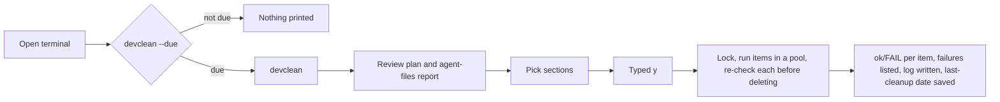

# Repo maintenance scripts

Node.js scripts for the folder that holds your git repos. They run on Windows (built for a Windows 365 Cloud PC), macOS and Linux. They need Node 18+ and git on PATH, and nothing else: no dependencies.

| Command | What it does | Default |
|---|---|---|
| `pull` (alias `gpall`) | `git pull --ff-only --prune` in every repo, in parallel; a branch without an upstream branch is skipped | runs immediately (a refused pull changes nothing) |
| `nmclean` | deletes `node_modules` in every repo, including workspace packages | plan, pick, confirm |
| `install` (alias `nminstall`) | lockfile-exact install: `npm ci`, `yarn install --frozen-lockfile` (Yarn 1) or `yarn install --immutable` (Yarn 2+) | plan, pick, confirm; one repo at a time |
| `devclean` | periodic cleanup: stale `node_modules`, old build outputs, old temp-folder entries, npm/Yarn 1 caches; review-only report of agent files | plan, pick, confirm |
| `token` (alias `npmrctoken`) | puts a new registry token into the `_authToken=` line of every `.npmrc`, in repos and their package folders | plan, pick, confirm |

The folder holds:

- `index.mjs`: the one entry point. It starts a command by name: `node index.mjs nmclean`.
- `lib/`: all code.
  - `lib/commands/`: one file per command; `devclean` has a folder with one file per section. `lib/commands/index.mjs` lists the commands; a new command is one new file plus one line there.
  - `lib/shared/`: the shared code, one file per area. It holds the safety checks and the plan → confirm → run flow of `nmclean`, `install`, `devclean` and `token`, which import it only through `lib/shared/index.mjs`. `pull` (`gpall.mjs`) is standalone: it deletes nothing, so it needs none of those checks, and it imports nothing from `lib/shared/`.
- `docs/`: the [glossary](docs/GLOSSARY.md), the [safety model](docs/safety-model.md), the [decisions](docs/adr/) and the [changelog](docs/CHANGELOG.md).
- `AGENTS.md`: working rules for coding agents; `CLAUDE.md` loads it.
- `tools/`: one-off diagnostics, run by hand. `tools/nmclean-timing.mjs` times each step of an `nmclean` dry run. They are not in the package and not linted.
- `tests/`: the tests, in `tests/commands/` and `tests/shared/` like the code they test. `tests/setup.mjs` prepares a test run; `tests/utils.mjs` builds files, repos and links for tests.

All the commands share these conventions:

- an optional bare number sets the number of parallel jobs;
- an `ok`/`FAIL` line is printed per item as it finishes;
- while a command plans or runs, a status line at the bottom shows what it is doing, how far it got and how long it has taken. It goes to stderr, so output sent to a file stays clean. Where the terminal can't redraw a line, a plain status line is printed every few seconds instead;
- failures are listed with details at the end;
- every item is attempted even after a failure;
- exit codes: `0` all ok, `1` some items failed, `2` refused before changing anything (including a mistyped option).

## Setup

The scripts travel as one package file. Nothing is published to a registry: `"private": true` in `package.json` makes npm refuse to publish.

1. In this repo, build the package:

   ```bash
   npm pack    # writes common-scripts-<version>.tgz with index.mjs, lib/, package.json and this README
   ```

2. Copy the `.tgz` file to the machine where you want the commands, for example the Cloud PC.
3. On that machine, install it:

   ```bash
   npm install -g ./common-scripts-<version>.tgz
   ```

   This adds the command `devkit` for your user, in Git Bash, PowerShell and cmd alike. It needs no administrator rights: on Windows, npm installs into `%AppData%\npm` ([npm folders](https://docs.npmjs.com/cli/v11/configuring-npm/folders)). It downloads nothing, because the package has no dependencies. Check it with `devkit --help`.
4. Optional: to see a reminder when a cleanup is due, add this line to your shell's startup file (`~/.bashrc` for Git Bash and most Linux shells, `~/.zshrc` on macOS):

   ```bash
   devkit devclean --due
   ```

To update, make a release with `node scripts/release.mjs minor` (or `major`, `patch`), as described at the top of [docs/CHANGELOG.md](docs/CHANGELOG.md). Then build the package again and install the new file the same way. It replaces the installed version.

While you work on the scripts, run `npm link` once in this repo instead. `devkit` then runs the code in the repo directly, so every change takes effect without a new package.

Run the commands from your repos folder, for example `devkit nmclean`. Each command has `--help`. In a terminal, `nmclean`, `install`, `devclean` and `token` print the plan, then show a list to pick from, then ask "[y/N]": type `y` to go ahead.

- the list holds `node_modules` folders for `nmclean`, repos for `install`, `.npmrc` files for `token`, and sections for `devclean`;
- move with the arrow keys and select with Space; Enter with nothing selected takes the line under the cursor; Esc cancels;
- where the terminal does not accept single keypresses, you type the numbers instead, e.g. `1,3,5-7`.

Other ways to run them:

- `--dry-run` only prints the plan. Without a terminal, for example when the output goes to a file, the commands only print the plan too.
- `--yes` takes everything, without the list and without the y/N question. The token command still requires a terminal for hidden token entry.
- `nmclean --only` narrows the plan to repo names or folder paths as the plan shows them (`devkit nmclean --only app-one,app-two/node_modules`); `devclean --only` takes section names.

If a script reports that there is no interactive terminal (Git Bash outside VS Code can do this), use the VS Code terminal or PowerShell, or add `--yes` after reviewing the plan.

### Updating the registry token

Run `devkit token` and paste the token at the hidden terminal prompt. Then review the plan, pick files and confirm. Use `devkit token --dry-run` to see the plan without writing.

The token is not placed in the command line or shell history. A terminal is required even with `--yes`.
Tokens are shown masked in the plan and log. The former `devkit token <token>` interface is no longer accepted.

## Workflow

There is no scheduled task ([decision 3](docs/adr/0003-confirm-no-schedule.md)). Instead, `--due` reminds you when you open a terminal, and you run the cleanup yourself.



## Safety model

What the scripts refuse, check and keep is in [docs/safety-model.md](docs/safety-model.md). The decisions behind the design are in [docs/adr/](docs/adr/), one file per decision.

## One-time check on Windows

On Windows the tests create junctions; on macOS and Linux, which have no junctions, they use folder symlinks. The check below also deletes a junction made by Windows' own `mklink /J`. Run it once in PowerShell before relying on the scripts on Windows:

```powershell
$t = "$env:USERPROFILE\devkit-smoke"
New-Item -ItemType Directory "$t\outside", "$t\work\app\node_modules\pkg" -Force | Out-Null
Set-Content "$t\outside\precious.txt" "keep me"
Set-Content "$t\work\app\node_modules\pkg\a.js" "x"
Set-Content "$t\work\app\package.json" "{}"
cmd /c mklink /J "$t\work\app\node_modules\linked" "$t\outside"
Set-Location "$t\work\app"; git init -q; Set-Content .gitignore "node_modules/"
Set-Location "$t\work"
devkit nmclean --yes
Test-Path "$t\outside\precious.txt"   # must be True
Test-Path "$t\work\app\node_modules"  # must be False
```

If the first `Test-Path` prints `False`, stop using the scripts and report the output.

## Checks

The scripts have no dependencies. `package.json` lists only the tools that check them: ESLint for lint and formatting, and TypeScript for types. These tools need Node 22 or later; the scripts themselves still run on Node 18.

```bash
npm install         # once, installs the check tools
npm run check       # lint, then type check, then tests
npm run format      # fix formatting and other auto-fixable lint findings
node --test         # tests only; needs no install
```

The house rules, each with its reason, are in `eslint.config.mjs`.

GitHub runs the same checks on Windows and Linux on every push ([.github/workflows/check.yml](.github/workflows/check.yml)).

To run the tests on Linux from macOS or Windows, use Docker from this folder. `node:18` is the oldest Node the scripts support; `node:22` is a current one.

```bash
docker run --rm --init -u node -v "$PWD":/work:ro -w /work node:18 node --test
docker run --rm --init -u node -v "$PWD":/work:ro -w /work node:22 node --test
```

Keep `--init`. Without it, `node` is the container's first process, and ended child processes are never cleared away. The test that kills a timed-out command then fails.

## Known limits

- **The tests have not been run on Windows.** They pass on macOS and Linux, where the Windows entry of the platform rules is tested too. These Windows behaviours need a real Windows disk or process:
  - junction handling (run the check above);
  - the `taskkill` tree kill;
  - whether a file in use always blocks the rename;
  - the arrow-key pick list in PowerShell (it works in Git Bash in the VS Code terminal);
  - the status line in PowerShell and the VS Code terminal.
- The scripts refuse to run inside a OneDrive folder, so keep your repos outside OneDrive. They find OneDrive through the `OneDrive…` environment variables that the OneDrive client sets; a OneDrive folder without them is not recognised.
- Yarn 2+ caches are per project and may be committed to git, so they are never cleaned. pnpm and bun projects are skipped.

## Sources

- [git pull](https://git-scm.com/docs/git-pull)
- [npm cache](https://docs.npmjs.com/cli/v11/commands/npm-cache), [Yarn cache clean (2+)](https://yarnpkg.com/cli/cache/clean)
